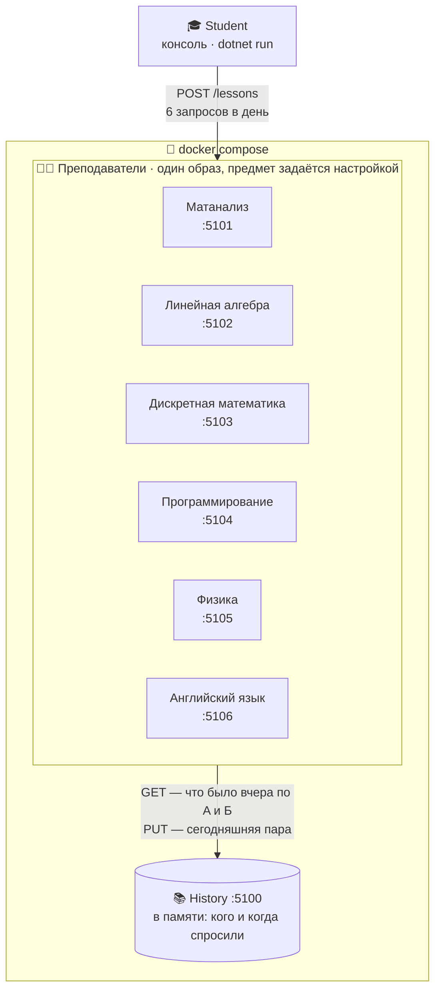
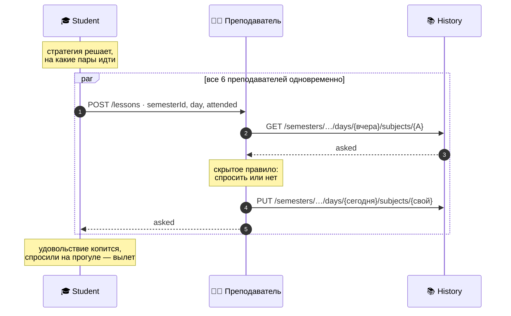

# 🎓 Лабораторные по C#

> Курс «Введение в C# и платформу .Net», НГУ ФИТ
> Задача: **«Мастер прогулов 80-го уровня»**

## 📖 О задаче

У студента каждый день шесть пар, семестр длится **100 дней**. На каждой паре преподаватель решает, спросить студента или нет, по одному из трёх скрытых правил:

| № | Правило |
|---|---------|
| 1 | Спросить случайно с вероятностью 50% |
| 2 | Спросить, если вчера спросили по предмету A |
| 3 | Спросить, если вчера спросили ровно по одному из предметов A и Б |

Студент правил не знает и видит только, спросили ли его на тех парах, где он был. Удовольствие копится от прогулов и от ежедневного пирожка. Если студента спросили на прогуле, он **вылетает**, и всё удовольствие сгорает.

## 🗂 Лабы

| Лаба | Тема | Что появилось |
|------|------|---------------|
| [lab1](#lab1--консольное-приложение) | Консольное приложение | Один прогон семестра и итог |
| [lab2](#lab2--generic-host) | Generic Host | Новый день каждые 5 секунд, сервисы и DI |
| [lab3](#lab3--unit-тесты) | Unit-тесты | xUnit, управляемый рандом |
| [lab4](#lab4--база-данных-postgresql) | PostgreSQL | Сохранение каждого дня, продолжение семестра |
| [lab5](#lab5--микросервисы-по-http) | Микросервисы по HTTP | Студент, 6 преподавателей и История — отдельные сервисы |

## ⚙️ Что нужно

- [.NET 10 SDK](https://dotnet.microsoft.com/download)
- [Docker](https://www.docker.com/) — только для lab4 и lab5

Все команды ниже выполняются **из корня репозитория**.

---

## lab1 — Консольное приложение

Прогоняет один семестр и печатает общее удовольствие и среднее за день.

### 📁 Структура

| Файл | Что внутри |
|------|------------|
| `Program.cs` | Запуск и вывод результата |
| `Semester.cs`, `SemesterResult.cs` | Прогон семестра и его итог |
| `StudentHistory.cs` | Что видел студент: был ли на паре, спросили ли |
| `EvenDaysStrategy.cs` | Стратегия студента |
| `RandomRule.cs`, `CopyYesterdayRule.cs`, `XorYesterdayRule.cs` | Три правила преподавателей |
| `TeacherRules.cs` | Случайный выбор правил на семестр |

### ▶️ Запуск

```bash
dotnet run --project lab1
```

---

## lab2 — Generic Host

Тот же семестр, но на Generic Host: **каждые 5 секунд новый день**. Программа останавливается при вылете или по нажатию любой клавиши. Логика разнесена по сервисам и подключена через DI.

### 📁 Структура

| Папка | Что внутри |
|-------|------------|
| `Program.cs` | Регистрация сервисов и запуск хоста |
| `Domain/` | Предметы |
| `Simulation/` | Семестр и фабрика семестров |
| `Students/` | Стратегия и история студента |
| `Teachers/` | Правила и их генератор |
| `Randomness/` | Источник случайных чисел, выделен, чтобы его можно было подменить |
| `Hosting/` | Фоновые сервисы (смена дней, ожидание клавиши) и вывод в консоль |

### ▶️ Запуск

```bash
dotnet run --project lab2
```

---

## lab3 — Unit-тесты

Код lab2 и тесты на **xUnit**. Весь рандом подменён управляемым источником, поэтому тесты детерминированы.

### 📁 Структура

| Папка | Что внутри |
|-------|------------|
| `Lab3/` | Приложение, такое же, как lab2 |
| `Lab3.Tests/Fakes/` | Управляемый рандом, заданная стратегия, правило с заготовленными ответами |
| `Lab3.Tests/Teachers/` | Тесты правил и генератора правил |
| `Lab3.Tests/Students/` | Тесты стратегии и истории студента |
| `Lab3.Tests/Simulation/` | Тесты дня семестра, «вчера», вылета и прогона целого семестра |

### 🧪 Что проверяется

- **Правила:** каждый преподаватель спрашивает строго по своему правилу
- **Стратегия:** решения при пустой, стабильной и смешанной истории; предметы не влияют друг на друга
- **Эмулятор:** все 4 сочетания «был/спросили» дают верный исход, «вчера» обновляется правильно, при вылете удовольствие обнуляется и следующие дни не играются

### ▶️ Запуск

```bash
dotnet test lab3/Lab3.slnx        # тесты
dotnet run --project lab3/Lab3    # приложение
```

---

## lab4 — База данных (PostgreSQL)

Каждый день семестра сохраняется в БД: удовольствие, номер дня, вылет, решения студента, кого спросили и сколько чисел выдал рандом. Правила преподавателей сохраняются при создании семестра. Можно **начать новый семестр** или **продолжить последний незавершённый** с того дня, где остановились.

### 📁 Структура

| Папка | Что внутри |
|-------|------------|
| `docker-compose.yml` | PostgreSQL для приложения |
| `Lab4/appsettings.json` | Строка подключения |
| `Lab4/Migrations/` | SQL-миграции, DbUp применяет их при каждом запуске |
| `Lab4/Persistence/` | `DatabaseMigrator`, `SemesterRepository` (только SQL), `Records/` (строки таблиц) |
| `Lab4/Simulation/` | Семестр. `SemesterService` переводит его в записи БД и обратно, при продолжении повторяет сохранённые дни и проверяет данные |
| `Lab4/Randomness/` | Рандом с зерном и счётчиком: после перезапуска продолжает ту же последовательность |
| `Lab4/Hosting/` | Режимы запуска, фоновые сервисы, вывод |
| `Lab4.Tests/Integration/` | PostgreSQL в Testcontainers и тесты сохранения и восстановления |
| `Lab4.Tests/…` | Unit-тесты из lab3 |

### 🗄 Таблицы

| Таблица | Что хранит |
|---------|------------|
| `semesters` | Зерно рандома и сколько чисел ушло на выбор правил |
| `teacher_rules` | Правило каждого преподавателя и его предметы A и Б |
| `days` | Прогресс на конец каждого дня |

### ▶️ Запуск

```bash
# 1. Поднять PostgreSQL (один раз)
docker compose -f lab4/docker-compose.yml up -d

# 2. Новый семестр
dotnet run --project lab4/Lab4 -- --new

# 3. Остановить любой клавишей и продолжить с того же места
dotnet run --project lab4/Lab4 -- --continue
```

### 👀 Посмотреть, что сохранилось

```bash
docker compose -f lab4/docker-compose.yml exec postgres psql -U postgres -d truancy -c "select * from days"
```

### 🧪 Тесты

Нужен запущенный Docker: PostgreSQL для тестов поднимается сам.

```bash
dotnet test lab4/Lab4.slnx
```

Интеграционные тесты проверяют, что:

- ✅ состояние, сохранённое на дне d, восстанавливается таким же
- ✅ продолжение после восстановления идёт так же, как прогон без остановки
- ✅ `--continue` не подхватывает законченные семестры

---

## lab5 — Микросервисы по HTTP

Семестр разнесён по сервисам, которые общаются по HTTP. **Студент** — консольное приложение: каждый день решает, на какие пары идти, и приходит к **преподавателям**. Преподавателей шесть, по одному на предмет, и у каждого своё скрытое правило. Чтобы узнать, что было вчера, преподаватель спрашивает **Историю** и записывает в неё сегодняшнюю пару.

### 🧭 Схема



### 📅 Как проходит день



Следующий день начинается только после всех 6 пар текущего, поэтому к его началу вчерашний день уже целиком лежит в Истории. У каждого семестра свой `semesterId`, так что История не смешивает разные запуски.

### 📁 Структура

| Проект | Что внутри |
|--------|------------|
| `Lab5.Contracts/` | Общий протокол: предметы, тела запросов и ответов, маршруты, правила разбора JSON |
| `Lab5.History/` | Minimal API, хранилище в памяти |
| `Lab5.Teacher/` | Minimal API. `Rules/` — три правила и их генератор, `History/` — клиент Истории, `Lecturer` проводит пару |
| `Lab5.Student/` | Generic Host. `Students/` — стратегия, `Simulation/` — семестр и проведение дня, `Http/` — клиент преподавателей, `Hosting/` — фоновые сервисы и вывод |
| `docker-compose.yml` | История и 6 преподавателей |

### ▶️ Запуск

```bash
# 1. Поднять Историю и преподавателей
docker compose -f lab5/docker-compose.yml up -d --build

# 2. Запустить студента: новый день каждые 5 секунд, остановка любой клавишей
dotnet run --project lab5/Lab5.Student

# То же, но быстрее
dotnet run --project lab5/Lab5.Student -- --Student:DayInterval=00:00:01

# 3. Остановить сервисы
docker compose -f lab5/docker-compose.yml down
```

### 👀 Посмотреть скрытые правила

Студент правил не знает. Каждый преподаватель пишет своё правило в лог при старте, а потом — каждую проведённую пару:

```bash
docker compose -f lab5/docker-compose.yml logs teacher-physics
```

Историю можно спросить напрямую (`{id}` — номер семестра, который печатает студент):

```bash
curl http://localhost:5100/semesters/{id}/days/1/subjects/Physics
```

### ⚠️ Если что-то пошло не так

| Что случилось | Что увидит студент |
|---------------|--------------------|
| Сервисы не запущены или преподаватель упал | Какой преподаватель и почему не ответил, выход с кодом 1 |
| Упала История | `502 (Bad Gateway)` от преподавателя и причина, которую он получил от Истории |
| Неверные настройки | Список ошибок в настройках, выход с кодом 1 |
