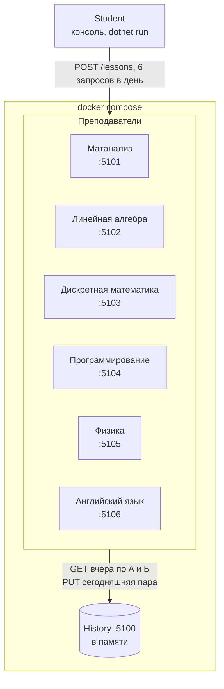
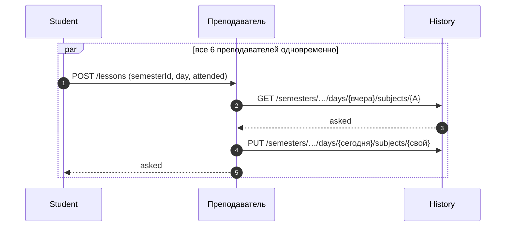
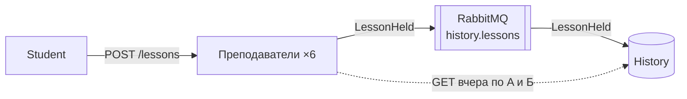
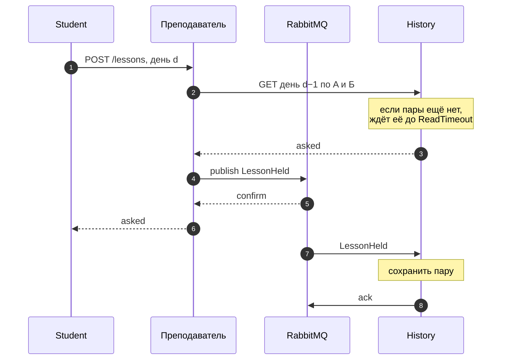

# Лабораторные по C#

Курс «Введение в C# и платформу .NET», НГУ ФИТ. Все шесть лаб решают одну задачу — «Мастер прогулов 80-го уровня», и каждая следующая достраивает предыдущую.

`.NET 10` · `Generic Host` · `xUnit` · `PostgreSQL` · `ASP.NET Minimal API` · `RabbitMQ` · `Docker Compose`

## Задача

У студента шесть пар в день, семестр длится 100 дней. На каждой паре преподаватель решает, спросить студента или нет. У каждого преподавателя одно из трёх правил:

1. спросить с вероятностью 50%;
2. спросить, если вчера спросили по предмету A;
3. спросить, если вчера спросили ровно по одному из предметов A и Б.

Студент правил не знает и видит только, спросили ли его на тех парах, где он был. Удовольствие копится за прогулы и за пирожок, который студент съедает каждый день. Если студента спросили на прогуле, он вылетает и теряет всё накопленное.

## Лабы

| Лаба | Тема | Что добавилось |
|:-----|:-----|:---------------|
| [lab1](#lab1-консольное-приложение) | Консольное приложение | Один прогон семестра и итог |
| [lab2](#lab2-generic-host) | Generic Host | Новый день каждые 5 секунд, сервисы и DI |
| [lab3](#lab3-unit-тесты) | Unit-тесты | xUnit, управляемый рандом |
| [lab4](#lab4-postgresql) | PostgreSQL | Сохранение каждого дня, продолжение семестра |
| [lab5](#lab5-микросервисы-по-http) | Микросервисы по HTTP | Студент, 6 преподавателей и История — отдельные сервисы |
| [lab6](#lab6-очереди) | Очереди | Преподаватели пишут в Историю через RabbitMQ |

Нужен [.NET 10 SDK](https://dotnet.microsoft.com/download), для lab4–lab6 ещё [Docker](https://www.docker.com/). Все команды запускаются из корня репозитория.

<br>

## lab1. Консольное приложение

Прогоняет один семестр и печатает общее удовольствие и среднее за день.

```bash
dotnet run --project lab1
```

<details>
<summary>Файлы</summary>

<br>

| Файл | Что внутри |
|:-----|:-----------|
| `Semester.cs`, `SemesterResult.cs` | Прогон семестра и его итог |
| `StudentHistory.cs` | Что видел студент: был ли на паре, спросили ли |
| `EvenDaysStrategy.cs` | Стратегия студента |
| `RandomRule.cs`, `CopyYesterdayRule.cs`, `XorYesterdayRule.cs` | Правила преподавателей |
| `TeacherRules.cs` | Случайный выбор правил на семестр |

</details>

<br>

## lab2. Generic Host

Тот же семестр на Generic Host. Новый день наступает каждые 5 секунд, программа останавливается при вылете или по нажатию любой клавиши. Логика разнесена по сервисам и собрана через DI.

```bash
dotnet run --project lab2
```

<details>
<summary>Папки</summary>

<br>

| Папка | Что внутри |
|:------|:-----------|
| `Domain/` | Предметы |
| `Simulation/` | Семестр и фабрика семестров |
| `Students/` | Стратегия и история студента |
| `Teachers/` | Правила и их генератор |
| `Randomness/` | Источник случайных чисел, вынесен отдельно, чтобы его можно было подменить |
| `Hosting/` | Фоновые сервисы (смена дней, ожидание клавиши) и вывод в консоль |

</details>

<br>

## lab3. Unit-тесты

Код lab2 и тесты на xUnit. Рандом в тестах заменён управляемым источником, поэтому результат каждого теста заранее известен.

```bash
dotnet test lab3/Lab3.slnx
dotnet run --project lab3/Lab3
```

Тесты проверяют, что:

- каждое правило спрашивает ровно так, как описано;
- стратегия ведёт себя правильно при пустой, стабильной и смешанной истории, а предметы не влияют друг на друга;
- все четыре сочетания «был / спросили» дают верный исход, «вчера» обновляется правильно, после вылета удовольствие обнуляется и следующие дни не играются.

<details>
<summary>Как устроены тесты</summary>

<br>

Тесты в `Lab3.Tests/` разложены по тем же папкам, что и код: `Teachers/`, `Students/`, `Simulation/`. В `Fakes/` лежат подделки: управляемый рандом, заданная стратегия и правило с заготовленными ответами.

</details>

<br>

## lab4. PostgreSQL

Каждый день семестра сохраняется в базу: удовольствие, номер дня, вылет, решения студента, кого спросили и сколько чисел выдал рандом. Правила преподавателей сохраняются при создании семестра. Можно начать новый семестр или продолжить последний незавершённый с того дня, на котором остановились.

```bash
docker compose -f lab4/docker-compose.yml up -d   # PostgreSQL, достаточно один раз
dotnet run --project lab4/Lab4 -- --new           # новый семестр
dotnet run --project lab4/Lab4 -- --continue      # продолжить после остановки
```

Посмотреть, что сохранилось:

```bash
docker compose -f lab4/docker-compose.yml exec postgres psql -U postgres -d truancy -c "select * from days"
```

| Таблица | Что хранит |
|:--------|:-----------|
| `semesters` | Зерно рандома и сколько чисел ушло на выбор правил |
| `teacher_rules` | Правило каждого преподавателя и его предметы A и Б |
| `days` | Состояние на конец каждого дня |

Кроме unit-тестов из lab3, здесь есть интеграционные. Они проверяют, что состояние, сохранённое на дне d, восстанавливается без изменений; что семестр после восстановления идёт так же, как без остановки; и что `--continue` не подхватывает законченные семестры.

```bash
dotnet test lab4/Lab4.slnx
```

> [!NOTE]
> Тестам нужен запущенный Docker: PostgreSQL для них поднимается сам через Testcontainers.

<details>
<summary>Папки</summary>

<br>

| Папка | Что внутри |
|:------|:-----------|
| `Migrations/` | SQL-миграции, DbUp применяет их при каждом запуске |
| `Persistence/` | `DatabaseMigrator`, `SemesterRepository` (только SQL) и строки таблиц в `Records/` |
| `Simulation/` | Семестр. `SemesterService` переводит его в записи БД и обратно, при продолжении повторяет сохранённые дни и сверяет данные |
| `Randomness/` | Рандом с зерном и счётчиком: после перезапуска продолжает ту же последовательность |
| `Hosting/` | Режимы запуска, фоновые сервисы, вывод |
| `appsettings.json` | Строка подключения |

</details>

<br>

## lab5. Микросервисы по HTTP

Семестр разнесён по сервисам, которые общаются по HTTP. Студент — консольное приложение: каждый день он решает, на какие пары идти, и приходит к преподавателям. Преподавателей шесть, по одному на предмет, все из одного образа; предмет задаётся настройкой. Чтобы узнать, что было вчера, преподаватель спрашивает Историю и записывает в неё сегодняшнюю пару.

```bash
docker compose -f lab5/docker-compose.yml up -d --build    # История и преподаватели
dotnet run --project lab5/Lab5.Student                     # день раз в 5 секунд, остановка любой клавишей
dotnet run --project lab5/Lab5.Student -- --Student:DayInterval=00:00:01
docker compose -f lab5/docker-compose.yml down
```



Следующий день начинается только после всех шести пар текущего, поэтому к его началу вчерашний день целиком лежит в Истории. У каждого семестра свой `semesterId`, и разные запуски в Истории не смешиваются.



Студент правил не знает, но каждый преподаватель пишет своё правило в лог при старте, а потом — каждую проведённую пару. Историю можно спросить напрямую, `{id}` — номер семестра, который печатает студент:

```bash
docker compose -f lab5/docker-compose.yml logs teacher-physics
curl http://localhost:5100/semesters/{id}/days/1/subjects/Physics
```

| Что случилось | Что увидит студент |
|:--------------|:-------------------|
| Сервисы не запущены или преподаватель упал | Какой преподаватель не ответил и почему, выход с кодом 1 |
| Упала История | `502 Bad Gateway` от преподавателя и причина, которую он получил от Истории |
| Неверные настройки | Список ошибок в настройках, выход с кодом 1 |

<details>
<summary>Проекты</summary>

<br>

| Проект | Что внутри |
|:-------|:-----------|
| `Lab5.Contracts/` | Общий протокол: предметы, тела запросов и ответов, маршруты, правила разбора JSON |
| `Lab5.History/` | Minimal API и хранилище в памяти |
| `Lab5.Teacher/` | Minimal API. В `Rules/` правила и их генератор, в `History/` клиент Истории, `Lecturer` проводит пару |
| `Lab5.Student/` | Generic Host. В `Students/` стратегия, в `Simulation/` семестр и проведение дня, в `Http/` клиент преподавателей, в `Hosting/` фоновые сервисы и вывод |

</details>

<br>

## lab6. Очереди

Продолжение lab5. Студент по-прежнему ходит к преподавателям по HTTP, и вчерашний день преподаватель тоже читает из Истории по HTTP. Изменилась запись: вместо `PUT` в Историю преподаватель кладёт пару в очередь RabbitMQ, а История забирает её оттуда в фоне.

```bash
cp lab6/.env.example lab6/.env                             # логин и пароль RabbitMQ, один раз
docker compose -f lab6/docker-compose.yml up -d --build    # RabbitMQ, История и преподаватели
dotnet run --project lab6/Lab6.Student -- --Student:DayInterval=00:00:01
docker compose -f lab6/docker-compose.yml down
```

Веб-интерфейс RabbitMQ открывается на http://localhost:15672, логин и пароль из `.env`. На вкладке Queues видна очередь `history.lessons`: сколько сообщений опубликовано, подтверждено и сколько ещё ждёт.



### Почему вчерашний день не теряется

Раз запись стала асинхронной, на следующий день пары за вчера в Истории может ещё не оказаться: сообщение уже в брокере, но История до него не дошла. Чтобы чтение вчерашнего дня не ломалось, работают четыре вещи:

1. Преподаватель отвечает студенту только после того, как брокер подтвердил, что принял сообщение (publisher confirms). Очередь durable, сообщения persistent, поэтому подтверждённая пара переживёт и перезапуск брокера.
2. Студент начинает следующий день, только получив все шесть ответов. Значит, к этому моменту все пары вчерашнего дня уже в брокере.
3. История подтверждает сообщение (ack) только после того, как сохранила пару. Если она упадёт раньше, брокер отдаст сообщение снова.
4. Остаётся задержка между брокером и Историей, и её закрывает `GET`. Если пары ещё нет, он ждёт её до `History:ReadTimeout` и только потом отвечает 404.



### Настройки и сбои

| Настройка | По умолчанию | Что задаёт |
|:----------|:-------------|:-----------|
| `History:ReadTimeout` | 5 с | Сколько `GET` ждёт пару, которой ещё нет |
| `Teacher:PublishTimeout` | 5 с | Сколько преподаватель ждёт подтверждения от брокера |
| `History:BrokerUrl`, `Teacher:BrokerUrl` | из `.env` | Адрес RabbitMQ; compose собирает его из `RABBITMQ_USER` и `RABBITMQ_PASSWORD` |

| Что случилось | Что будет |
|:--------------|:----------|
| RabbitMQ недоступен при старте | История и преподаватели пишут, к чему не смогли подключиться, и выходят с кодом 1 |
| RabbitMQ остановился посреди семестра | Студент получает 502 «нет соединения с брокером» и выходит. Когда брокер вернётся, сервисы переподключатся сами |
| Упала История | Пары копятся в очереди. Преподаватель не может прочитать вчерашний день, студент получает 502 с причиной |
| Пара не дошла до Истории за `ReadTimeout` | 502 «В Истории нет записи о паре…» |
| В очередь попало битое сообщение | История пишет причину в лог и выбрасывает сообщение, не возвращая его в очередь |

> [!NOTE]
> История, как и в lab5, хранит пары в памяти: после её перезапуска записи пропадают.

<details>
<summary>Что изменилось в коде по сравнению с lab5</summary>

<br>

| Где | Что |
|:----|:----|
| `Lab6.Contracts/` | Сообщение `LessonHeld` и имя очереди `HistoryQueues.Lessons` |
| `Lab6.Teacher/Queue/` | `RabbitLessonPublisher`: подключается к брокеру при старте и публикует каждую пару с подтверждением |
| `Lab6.History/LessonQueueConsumer.cs` | Фоновый сервис, который читает очередь |
| `Lab6.History/InMemoryHistoryStore.cs` | `WaitAsync` ждёт пару, которой ещё нет |
| `Lab6.History/HistoryEndpoints.cs` | `PUT` убран, записать в Историю теперь можно только через очередь |
| `Lab6.Student/` | Не менялся |

</details>
